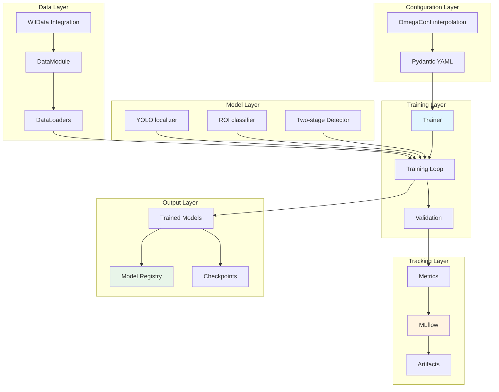

# WildTrain Architecture

WildTrain trains a class-agnostic Ultralytics YOLO localizer and an ROI classifier (PyTorch Lightning), then registers those models with MLflow for the census app. MMDetection is not a backend.

## Overview

**Purpose**: Flexible model training and evaluation framework

**Key Responsibilities**:
- Model training (detection and classification)
- Experiment tracking with MLflow
- Hyperparameter optimization
- Model evaluation and metrics
- Model registration and versioning

## Architecture Diagram



## Core Components

### 1. Model Architectures

#### Supported Architectures
- **YOLO localizer**: Ultralytics YOLO trained as a single class (`single_cls: true`). This is the detection model the product uses.
- **ROI classifier**: PyTorch Lightning classifier on crops cut from detection boxes, with a timm backbone.
- **Two-stage detector**: inference composition of that localizer and classifier. Training them is two separate runs, not a third framework.

MMDetection is not supported.

### 2. Data Modules

#Standardized data loading components that integrate with WilData to feed training and validation batches into the models:
- **Detection DataModule**: Handles bounding box datasets and associated image transformations.
- **Classification DataModule**: Handles ROI-based classification datasets with standard image augmentations.

### 3. Training Orchestration

#### Main Trainer
The training orchestrator manages the lifecycle of a training run, including experiment initialization, model instantiation, training loop execution, and model serialization.

### 4. Evaluation System

#### Metrics Computation
Integrated tools for calculating standard performance metrics:
- **Classification Metrics**: Accuracy, Precision, Recall, and F1-Score.
- **Detection Metrics**: Mean Average Precision (mAP) at various IoU thresholds.

### 5. Hyperparameter Optimization

#### Optuna Integration
WildTrain integrates with Optuna to automate the search for optimal training hyperparameters like learning rate, batch size, and architectural configurations.

### 6. Model Registration

#### MLflow Model Registry
Models are automatically registered in the MLflow Model Registry, allowing for versioning, lifecycle stage management (Staging/Production), and metadata tracking.

## Configuration System

Training configs are Pydantic models loaded from YAML. OmegaConf resolves `${...}` interpolations before validation. The CLI is Typer, not Hydra, and there is no `main.py` config group.

`wildtrain run -c experiment.yaml` loads one `ExperimentConfig`. The file has shared `tracking`, `run`, and optional `sweep` blocks, plus either a `classification` or a `detection` body. Those bodies are the existing training configs. A flat training YAML still loads, with or without a top-level `task` key. `wildtrain train detector` and `wildtrain train classifier` are adapters onto that loader. `wildtrain sweep -c` runs one Optuna study for either task.

```bash
wildtrain run -c path/to/experiment.yaml
wildtrain sweep -c path/to/sweep.yaml
wildtrain train detector -c configs/detection/yolo_configs/yolo.yaml
wildtrain train classifier -c configs/classification/classification_train.yaml
```

The field layout and the legacy conversion are in the WildTrain README.

## CLI Interface

Training, evaluation, and tuning operations are all exposed via a CLI built with Typer. Complete documentation is available in the [CLI Reference](../api-reference/wildtrain-cli.md).


## Next Steps

- [WildDetect Architecture →](wildetect.md)
- [Data Flow Details →](data-flow.md)
- [Training Tutorial →](../tutorials/model-training.md)
- [WildTrain Scripts →](../scripts/wildtrain/index.md)

