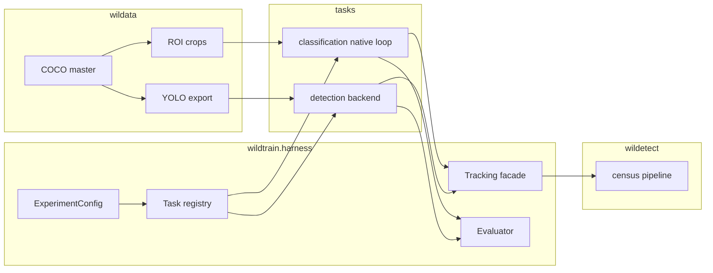

# Training harness assessment

Assessment of whether this repository can become a general training harness for object detection and image classification, and a proposed target design. This document is a design proposal only. It does not change runtime code.

**Recommendation: refactor into a new package inside this repo.** Add `wildtrain.harness` beside the current trainers and migrate one task at a time. Do not start a new repository. Do not try to turn the existing `ClassifierTrainer` / `UltralyticsDetectionTrainer` classes into the long-term abstraction by editing them in place.

## Decisions

Recorded from Fadel before the first implementation slice. These override the open questions they answer.

| Topic | Decision |
| --- | --- |
| Product | The class-agnostic localizer plus an ROI classifier stays the priority. Multi-class YOLO is not the primary detector. |
| Classification data | ROI crops only. No image-folder, CSV, Hugging Face, or Label Studio classification loaders in the planned work. |
| MMDetection | Not needed. Drop the promise, the docs that describe it, and the unused `hydra-core` and `openmim` dependencies. Detection backends stay Ultralytics YOLO, with `custom_yolo` still isolated later. |
| First slice | Phase 0 (characterization tests, doc corrections, dependency removal) and phase 1 (`wildtrain.harness` skeleton). Do not move `GenericClassifier` or `yolo_utils.py`. Do not change the census model contract. |

Image-folder classification and multi-class detection stay possible later because the task registry can grow. They are not milestones. Phase 2 below is ROI-only. Phase 3 keeps `single_cls: true` as the supported detector path; lifting that assertion is optional follow-up work, not part of making the harness real.

The monorepo split is already right: `wildata` prepares data, `wildtrain` trains, `wildetect` runs census campaigns. The gap is inside `wildtrain`. Detection and classification are two parallel applications that share a name, a Typer binary, and a Pydantic config style. They do not share a training loop, a dataset contract, a metric contract, or a model interface. A large fraction of the code that looks like a framework is either a thin wrapper around Ultralytics or wildlife-specific policy hardcoded as a precondition.

---

## 1. What the repository actually is

The uv workspace (`pyproject.toml`) has three members.

| Package | Role | Python LOC (src, excluding tests) | Entry point |
| --- | --- | --- | --- |
| `wildata` | Detection dataset IO: COCO, YOLO, Label Studio, tiling, ROI crops, DVC, FastAPI | ~14.1k | `wildata = wildata.cli:app` |
| `wildtrain` | Training, eval, sweeps, MLflow registration, inference server | ~14.9k | `wildtrain = wildtrain.cli:app` |
| `wildetect` (`src/wildetect`) | Aerial census product: tiling, GPS, flight merge, FiftyOne, Reflex/Streamlit UI | ~16.7k | `wildetect = wildetect.cli:app` |

Dependency direction matches `docs/architecture/overview.md`: `wildata` stands alone, `wildtrain` imports `wildata`, `wildetect` imports `wildtrain` models. That direction should stay.

`wildtrain` already advertises both tasks. The CLI (`wildtrain/src/wildtrain/cli/cli.py`) exposes `train`, `evaluate`, `register`, `pipeline`, `visualize`, and `dataset`, and each of those groups has a classifier command and a detector command. Config types are an enum of paired variants in `wildtrain/src/wildtrain/shared/config_types.py` (`CLASSIFICATION`, `DETECTION`, plus eval, visualization, pipeline, and registration twins). The FastAPI surface repeats the split (`POST /classifier` and `POST /detector` in `wildtrain/src/wildtrain/api/routers/training.py`).

The published architecture does not match the code:

- Before this slice, `wildtrain/README.md` and `docs/architecture/wildtrain.md` described Hydra, `python main.py task=detection`, and MMDetection. Nothing imported Hydra, MMDetection, or OpenMIM. Those docs are corrected, and `hydra-core` and `openmim` are no longer dependencies. OmegaConf remains the YAML loader.
- `docs/tutorials/model-training.md` shows a flat Ultralytics YAML (`model:`, `data:`, `epochs:`). The loader actually requires `DetectionConfig` (`dataset`, `curriculum`, `pretraining`, `model`, `train`, `mlflow`, …) in `wildtrain/src/wildtrain/shared/schemas/detection.py`.
- `utils/registry.py` defines a `Registry` and nothing constructs it.

What runs today:

```text
wildtrain train classifier -c <ClassificationConfig>
    -> ClassifierTrainer.run
        -> ClassificationDataModule (ROI or dynamic crops)
        -> lightning.Trainer.fit(ClassifierModule)

wildtrain train detector -c <DetectionConfig>
    -> UltralyticsDetectionTrainer.run
        -> optional pretrain, optional curriculum ratios
        -> ultralytics.YOLO.train(**train_cfg)     # or CustomYOLO

wildtrain evaluate classifier | detector
    -> ClassificationEvaluator | UltralyticsEvaluator
```

`ModelTrainer` (`wildtrain/src/wildtrain/trainers/base.py`) is the only shared training type. Its contract is `__init__(config)` plus `run()`. That is not enough to hang a second task on, and the two subclasses do not honor it the same way (`run(self, debug: bool = False)` adds an argument the base class does not declare).

---

## 2. How much is reusable

Roughly half of `wildtrain` is worth keeping as the body of a harness. The other half is either a wildlife workflow or a duplicate of the first task. `wildata` and `wildetect` should stay where they are.

### Keep and retarget

| Piece | Where | Why it survives |
| --- | --- | --- |
| Pydantic YAML loading | `shared/schemas/base.py`, `shared/config_loader.py` | `from_yaml` / `load_and_validate` already resolve OmegaConf interpolations (the classification config uses `${dataset.input_size}`) and print field errors. The schema *contents* are task-forked; the loader mechanism is not. |
| Shared config atoms | `shared/schemas/common.py` | `MLflowConfig`, `TransformsConfig`, `CurriculumConfig`, `SingleClassConfig` are the right shape for a common experiment header. |
| Lightning classifier | `models/classifier.py`, `trainers/classification_trainer.py` | A real training loop: timm backbone, MLP head, Adam + cosine restarts, checkpointing, early stopping, per-class torchmetrics. This is the template for any future native task. |
| Classification metrics | `evaluators/classification.py` | Accuracy, precision, recall, F1, AUROC, average precision, with per-class keys. Duplicated inside `ClassifierModule`, but the metric set is the right one. |
| Detection metrics | `evaluators/ultralytics.py`, `evaluators/metrics.py` | supervision mAP / mAR plus custom precision, recall, F1 over IoU thresholds. Independent of Ultralytics' own fitness, which is what you want in a harness. |
| MLflow registration | `models/register.py`, `utils/mlflow.py` | `ModelMetadata`, pyfunc wrappers, alias download. `wildetect` already loads this (`src/wildetect/core/detectors/base.py` calls `load_registered_model`). This contract is production, not scaffolding. |
| Optuna base | `shared/sweeper.py` | Abstract study loop. The two sweepers in `trainers/sweepers.py` (~635 lines) duplicate it per task. |
| DVC dataset logging | `utils/dvc_tracker.py` | Used by classification training. Detection training does not call it. Easy to lift into a tracking facade. |
| Transform builder | `utils/transforms.py` | Name-and-params torchvision transforms from YAML. Task-agnostic. |
| ROI classification dataset | `wildata/src/wildata/datasets/roi.py` | Real `torch.utils.data.Dataset` of crops plus `class_mapping.json`. Needed for the species classifier even after the harness is general. |
| Format conversion | `wildata` adapters, converters, validators, `FrameworkDataManager` | COCO master format, YOLO export, Label Studio import, tiling. This is data engineering, not a trainer. |
| Job runner | `wildtrain/src/wildtrain/api/utils/background_tasks.py` | Task-agnostic job queue. The routers in front of it are task-specific. |
| Pipeline shell | `pipeline/classification_pipeline.py`, `pipeline/detection_pipeline.py`, `schemas/pipeline.py` | Both pipelines are the same three steps: load train config, `trainer.run`, point eval weights at `best_model_path`, write a report. One pipeline with a task plugin replaces both classes. |

### Keep as domain plugins, not as the framework

| Piece | Where | Why it is not the harness |
| --- | --- | --- |
| Two-stage detector | `models/detector.py`, `models/localizer.py` | Inference composition: class-agnostic localizer, then ROI classifier. `wildetect` calls it. It is a product model, not a training task. |
| Custom YOLO | `trainers/yolo_utils.py` (~1004 lines) | Forks `v8DetectionLoss`, `DetectionModel`, and `DetectionTrainer` to add count, area, and FP/TP losses plus a timm encoder (`YoloCustomConfig`). Valuable research code. Fragile against Ultralytics upgrades (`wildtrain` pins `ultralytics>=8.3.168`, the root pins `>=8.3.162`). |
| Curriculum on boxes | `data/curriculum/` (~865 lines in `dataset.py`) | Difficulty filtering over `supervision.DetectionDataset`. Useful for aerial data. Coupled to COCO annotations. |
| Mining filters | `data/filters/algorithms.py` (~756 lines) | Clustering, rebalance, hard-sample selection for detection crops. Wildlife data prep, not a training loop. |
| Census stack | `src/wildetect/core/` | Tiling, raster IO, GPS, flight merge, campaign reports. Consumes a registered detector. Out of scope for the harness. |

### Do not carry forward as design

- The unused `Registry` stub. `openmim` is removed. `hydra-core` is no longer a direct dependency (DVC still pulls it in). Architecture docs that described Hydra and MMDetection are corrected in the phase 0 change.
- `ConfigType`'s if/elif ladder and the parallel request models in `api/models/requests.py`.
- The assertion that every dataset is single-class `"wildlife"` (see section 3).
- A second copy of classification metrics inside the Lightning module and a second copy of detection training metrics inside Ultralytics.

If the decision were still to start a new repository, the carry-over list is the "Keep and retarget" table plus the two-stage `Detector` and `load_registered_model`, copied or depended on so census keeps working. Everything else would be rewritten and the tests that pin today's YAML shapes would be lost. That cost is not justified: the reusable code is already in this workspace, and the parts that are wrong are localized.

---

## 3. Coupling that blocks a general harness

These are the points where detection (and the wildlife two-stage workflow) is baked into code that would have to be shared.

### 3.1 There is no shared loop

`UltralyticsDetectionTrainer._train` (`trainers/detection_trainer.py`) builds a data YAML, calls `self.model.train(...)`, and reads `self.model.trainer.best`. Optimizer, augmentation, loss, checkpointing, and the MLflow toggle (`settings.update({"mlflow": True})`) all belong to Ultralytics.

`ClassifierTrainer.run` builds a `lightning.Trainer` with its own callbacks and an `MLFlowLogger`.

A harness cannot grow by adding methods to `ModelTrainer`. Detection does not own the loop it would need to share. The honest split is:

- **Native tasks** (classification now, a custom detector later) run inside one Lightning (or plain PyTorch) loop the harness owns.
- **Delegated backends** (Ultralytics, and CustomYOLO) implement `fit()` and `predict()`. The harness owns config, dataset prep, tracking, and evaluation around them.

Pretending both are Lightning modules on day one means rewriting YOLO training. That is a research project, and `yolo_utils.py` shows how deep the fork gets.

### 3.2 Task identity is a fork, not a plugin

Every layer has a classification type and a detection type instead of one type plus a task name:

- Schemas: `ClassificationConfig` vs `DetectionConfig` (the latter is a YOLO config: `YoloTrainConfig`, `YoloDatasetConfig`, `YoloCurriculumConfig`).
- Loaders: `ConfigLoader.load_classification_config` vs `load_detection_config`, and `validate_config_file` is a 20-branch `if/elif` (`shared/config_loader.py`).
- CLI: `train classifier` and `train detector` (`cli/commands/train.py`). Eval adds a third command, `evaluate yolo_model`, which skips Pydantic and calls `YOLO.val` on a raw dict (`cli/commands/evaluate.py`).
- API: `ClassificationTrainingRequest` and `DetectionTrainingRequest`.
- Sweep: `ClassifierSweeper` and `DetectionSweeper` each hardcode `trial.suggest_categorical` for that task's fields.
- Pipelines: `ClassificationPipeline` and `DetectionPipeline` differ mainly in which class they construct and which weight field they overwrite (`classifier` vs `weights.localizer`).

Adding segmentation (already named in `ModelTask.SEGMENT` and in `DetectionEvalParamsConfig.task`) means another copy of all of the above. That is the extensibility failure.

One concrete bug in the same ladder: `ConfigType.DETECTOR_REGISTRATION` is validated with `load_localizer_registration_config`, while `generate_default_config` maps `MODEL_REGISTRATION` to `DetectorRegistrationConfig` and `DETECTOR_REGISTRATION` to `LocalizerRegistrationConfig` (`shared/config_loader.py`). The registration schemas themselves (`LocalizerRegistrationConfig`, `ClassifierRegistrationConfig`, `DetectorRegistrationConfig`) are the right domain objects; the dispatch table is not.

### 3.3 Single-class wildlife is a precondition, not a label policy

The two-stage product trains a class-agnostic localizer and a binary ROI classifier (`background` vs `wildlife`). That is a legitimate experiment. It is currently enforced inside the components a general harness would reuse:

- `UltralyticsDetectionTrainer.__init__` raises unless `config.train.single_cls` (`trainers/detection_trainer.py`). The class also stores `self.single_class_name = "wildlife"`.
- `ClassificationDataModule.__init__` raises unless `load_as_single_class` (`data/classification_datamodule.py`). Multi-class image classification cannot be turned on from YAML.
- `DetectionCalibrator` asserts `single_cls` (`evaluators/calibrator.py`).
- `UltralyticsLocalizer` sets `self.class_agnostic = True` with the comment "single class detection is localization" (`models/localizer.py`). When the YOLO model has one name, predicted class ids are shifted by +1 in `_update_class_mapping`. Census code depends on that shift.
- Defaults named `"wildlife"` appear in `ROIDataset`, the wildata CLI, FiftyOne helpers, and the example YAMLs (`configs/classification/classification_train.yaml`, `configs/detection/yolo_configs/yolo.yaml`), including a discard list of `rocks`, `vegetation`, `other`, `termite mound`.

`SingleClassConfig` already models this as optional policy (enable flag, background name, keep/discard lists). The trainers ignore that and refuse to run when the flag is off. General classification and multi-class detection are blocked by assertions, not by missing model code.

### 3.4 Datasets are detection-shaped

`wildata` stores a COCO master and exports `coco`, `yolo`, and `roi` (`pipeline/framework_data_manager.py`, `pipeline/data_pipeline.py`). There is no image-folder or class-subdirectory classification format.

`ClassificationDataModule` supports `dataset_type` `"roi"` or `"crop"`. ROI reads pre-cut boxes (`ROIDataset`). Crop dynamically samples boxes out of a detection dataset (`CurriculumDetectionDataset`, `PatchDataset` in `data/curriculum/dataset.py`). Both paths assume bounding boxes exist. A standard classification tree (`train/<class>/*.jpg`) has no loader.

Detection training does not use a PyTorch dataset at all. It points Ultralytics at a YOLO `data.yaml`, optionally merged by `utils/io.py:merge_data_cfg`, then filtered by `FilterDataCfg` (`data/filters/algorithms.py`). Evaluation reloads images through `data/utils.py:load_all_detection_datasets`. Train and eval therefore see different dataset objects.

`ROIDataset` also defaults `discard_classes` to a wildlife list (`wildata/src/wildata/datasets/roi.py`). A caller who passes `None` intending "keep everything" still drops vegetation, rocks, and similar labels.

### 3.5 Model backends are closed

`GenericClassifier` documents "timm and MMPretrain". `_get_backbone` only accepts `backbone_source == "timm"`. The rejection is not raised: it constructs `ValueError(...)` and continues into `timm.create_model` (`models/classifier.py`). `FeatureExtractor` (`models/feature_extractor.py`) is a second timm loader with no shared backbone factory.

Detection has one backend class (`UltralyticsLocalizer`) and one training class (`UltralyticsDetectionTrainer`), plus `CustomYOLO` selected by `use_custom_yolo`. There is no detector interface a non-YOLO model could implement. `ObjectLocalizer` is inference-only (`predict` / `predict_sahi`).

### 3.6 Logging, checkpoints, and eval are per task

| Concern | Classification | Detection |
| --- | --- | --- |
| Tracker | Lightning `MLFlowLogger` plus a manual `mlflow.log_artifact` of the checkpoint | Ultralytics `settings.mlflow = True` and `mlflow.set_tracking_uri` |
| Required env | `ENV_FILE` must exist and define `MLFLOW_TRACKING_URI` (`ClassifierTrainer.get_callbacks`) | `MLflowConfig.tracking_uri` on the config |
| Dataset provenance | `track_dataset()` via DVC, and only if `config.track_dataset` is set (that field is not on `ClassificationConfig`) | Not called |
| Best checkpoint | `trainer.checkpoint_callback.best_model_path` | `self.model.trainer.best` (Ultralytics fitness, typically mAP50) |
| Train metrics | torchmetrics logged as `val_accuracy`, `val_f1score`, … | Whatever Ultralytics writes |
| Eval metrics | A second torchmetrics pass in `ClassificationEvaluator` | supervision metrics in `UltralyticsEvaluator`, not Ultralytics `model.val` (that path is the separate `evaluate yolo_model` command) |

A shared experiment table in MLflow is not possible until both tasks go through one tracking facade. Unifying them carelessly will also split history, because run names, artifact paths (`checkpoint/` vs Ultralytics `project/name`), and metric keys differ.

### 3.7 The inference server is the two-stage detector

`server.py` is a LitServe app that loads a registered `Detector` from MLflow env vars (`MLFLOW_REGISTRY_NAME`, `MLFLOW_ALIAS`, `MLFLOW_TRACKING_URI`). `wildetect`'s `BaseDetectionPipeline` either does the same load or calls `Detector.predict_inference_service`. A general `predict` CLI does not exist. Classification inference is checkpoint loading inside the evaluator and the SHAP explainer (`explainers/shap.py`), which is classifier-only.

### 3.8 Tests do not lock the training contract

`wildtrain/tests` covers the HTTP API (health, jobs, config, a training route) and data utilities (filtering, crop clustering, rebalance, curriculum). There is no test that a classification step decreases loss or that a detection config round-trips into `YOLO.train` arguments. `wildata/tests` is in better shape (adapters, converters, ROI, partitioning). `tests/` at the repo root covers census, tiles, and GPS.

That means a refactor can move structure without a behavioral safety net, unless characterization tests are added first. It also means a from-scratch rewrite would not be "throwing away a tested framework."

### 3.9 Smaller defects that a new schema should not copy

- `BaseConfig.to_yaml` types `yaml_path` as `str` and then calls `yaml_path.parent` (`schemas/base.py`).
- `ClassificationDatasetConfig.validate_crop_fields` and `ClassificationConfig.validate_model_dataset_compatibility` use `info.data` as an object. In Pydantic v2 `info.data` is a dict, so those checks do not run.
- `ClassificationEvaluator._load_data` reads `dataset.single_class.enable` with no None guard, while the field is `Optional`.
- Example configs contain absolute Windows paths (`D:\PhD\workspace\...`) and `ClassificationDatasetConfig` rejects a root that does not exist on the machine loading the file. Templates cannot be validated in CI.
- `shared/models.py` is marked deprecated and is still the import path used by trainers, evaluators, and the API.

None of these are reasons to leave the repo. They are reasons not to treat the current schema hierarchy as the target.

---

## 4. Recommendation

**Build the harness as a new subpackage, `wildtrain.harness`, inside this repository, and migrate call sites onto it.** Leave `wildata` and `wildetect` in place. Keep the `wildtrain` console script.

### Why not start fresh

A new repo would reimplement the pieces that already work: Lightning classification, Pydantic loading, MLflow registration, supervision detection metrics, ROI datasets, DVC tracking, the Optuna study loop, and the FastAPI job runner. It would also break the only production consumer. `src/wildetect/core/detectors/base.py` imports `wildtrain.models.detector.Detector` and `wildtrain.utils.mlflow.load_registered_model`. The census app does not care how training is structured; it cares that a registered pyfunc still unwraps to an object with `set_device`, `metadata`, and a detection forward. Recreating that in another repository buys a clean tree and costs a compatibility project.

The code that feels "too detection-specific to save" is already separable. `yolo_utils.py`, curriculum, and the wildlife label policy can sit behind flags. They do not infect `GenericClassifier` except for the single-class assertion in the datamodule.

### Why not refactor only in place

In-place means editing `ClassifierTrainer`, `UltralyticsDetectionTrainer`, `ConfigLoader`, and the paired API models until they look like one system. The module boundaries are the problem: each layer is a pair of classes. Stretching `ModelTrainer.run()` over a Lightning loop and an Ultralytics `model.train()` call produces a facade. Callers in the CLI, the API, and `wildetect` would change at the same time as the internals, with no frozen contract and almost no training tests.

In-place cleanups are still worth doing inside the migration (the missing `raise`, the registration dispatch bug, deleting unused Hydra docs). They are not the design.

### Why a new package inside this repo

`wildtrain.harness` can exist next to `trainers/`, `evaluators/`, and `pipeline/` . Old commands become adapters that build a harness `ExperimentConfig` and call `run_experiment`. New commands call the harness directly. `wildetect` keeps importing `Detector` until a later phase, and only the metadata keys it reads need to stay stable.

Prefer a subpackage of `wildtrain` over a fourth workspace member. A fourth installable (`wildharness`) adds packaging, a dependency edge, and an import migration for no isolation benefit: the harness must import `wildata` datasets and the existing models anyway. Split it out only if some later user needs the trainer without the wildlife inference server.

What "done" means: a new task is a registered class plus a schema fragment. It does not require a new CLI command, a new `ConfigType` enum value, a new API router, and a new pipeline class.

---

## 5. Target architecture

```text
wildtrain/src/wildtrain/
  harness/
    task.py            # Task protocol and run_experiment()
    registry.py        # tasks, backbones, detector backends, metrics
    config.py          # ExperimentConfig (discriminator: task)
    tracking.py        # MLflow + optional DVC + checkpoint record
    eval.py            # Evaluator protocol and metric registry
    sweep.py           # one Optuna runner; the task declares the search space
    cli.py             # `wildtrain run` / `eval` / `sweep` by task field
  tasks/
    classification/
      config.py        # ClassificationSpec (native)
      data.py          # ROI crops only; other layouts are out of scope
      module.py        # current ClassifierModule, metrics injected
      model.py         # GenericClassifier moved here; timm backbone via registry
    detection/
      config.py        # DetectionSpec
      data.py          # YOLO/COCO prep (merge, class filter) — no training loop
      backends/
        ultralytics.py # today's UltralyticsDetectionTrainer._train
        custom_yolo.py # yolo_utils.py, imported only when selected
      eval.py          # current UltralyticsEvaluator
    two_stage/         # later, optional: chain localizer training + ROI classifier
  models/              # inference objects wildetect already imports
    detector.py        # unchanged public API during migration
    localizer.py
    register.py
  trainers/            # shims that delegate to harness.tasks, then deleted
  cli/commands/        # old `train classifier` calls harness, then deprecated
```

`wildata` stays the detection and ROI pipeline. No new classification export is required. GPS, tiling, and camp partitioning stay in `wildata`. Census, raster inference, and the UI stay in `wildetect`.



### 5.1 Task interface

A task is a small object registered by name. The harness calls it; the task does not subclass a 400-line trainer.

```python
class Task(Protocol):
    name: str

    def build_data(self, cfg: ExperimentConfig) -> DataHandle: ...
    def build_model(self, cfg: ExperimentConfig, data: DataHandle) -> ModelHandle: ...
    def fit(self, cfg: ExperimentConfig, model: ModelHandle, data: DataHandle, tracker: Tracker) -> FitResult: ...
    def evaluate(self, cfg: ExperimentConfig, result: FitResult, data: DataHandle) -> Report: ...
    def search_space(self, trial: optuna.Trial, cfg: ExperimentConfig) -> None: ...
```

`FitResult` is the shared checkpoint contract both tasks lack today: `best_path`, `best_score`, `score_name`, `run_id`. Classification fills it from `ModelCheckpoint`. The Ultralytics backend fills it from `trainer.best` and `best_fitness`. Pipelines and sweeps read only `FitResult`.

`DataHandle` / `ModelHandle` are intentionally opaque. A native task's handle is a `LightningDataModule` and a `LightningModule`. A delegated backend's handle is a path to `data.yaml` and a `YOLO` instance. The protocol does not force those to be the same type.

Registration replaces the unused `Registry` and the `ConfigType` ladder:

```python
tasks = TaskRegistry()
tasks.register("classification", ClassificationTask)
tasks.register("detection", DetectionTask)
```

Entry-point registration (`[project.entry-points."wildtrain.tasks"]`) can wait until a third party needs to ship a task out of tree. An in-process dict is enough for detection, classification, and a later segmentation plugin.

### 5.2 Two execution strategies

**Native.** The harness constructs one `lightning.Trainer` (callbacks, precision, accelerator, logger) from the shared `train` block. The task supplies the `LightningModule` and the `LightningDataModule`. Classification moves here unchanged in behavior. A future detector written in PyTorch uses the same loop. This is the extension path.

**Delegated.** `DetectionTask.fit` calls `DetectorBackend.fit(data_yaml, train_cfg) -> FitResult`. The first backend is today's `YOLO.train` path. The second is `CustomYOLO`, constructed only when `model.backend: custom_yolo`. The harness still runs dataset prep, tracking, and `evaluate()` itself, so Ultralytics fitness is recorded as a backend score and the published metrics stay the supervision report.

Do not put count/area/FP-TP loss into the default detection task. Those heads know about aerial boxes and a frozen DINOv2 encoder. They are a backend.

### 5.3 Config schema

One document, discriminated by `task`. Shared blocks are the current `MLflowConfig`, seed, and a small train header. Task blocks keep the fields that are actually task-specific. Existing YAML files keep working through adapters in phase 1 (see migration), so this schema is the target, not a flag day.

```yaml
task: classification          # registered name
name: base_dinov2
seed: 41

tracking:
  mlflow:
    tracking_uri: http://127.0.0.1:5000
    experiment_name: wildtrain_classification
    run_name: base_dinov2
    log_model: true
  dvc:
    enabled: false

data:
  format: roi                  # roi is the only classification format in scope
  root: ${oc.env:DATA_ROOT}   # no machine-absolute default
  batch_size: 64
  num_workers: 4
  input_size: 384
  label_policy:               # optional; replaces the hard single-class assert
    mode: collapse            # identity | collapse
    positive_name: wildlife
    background_name: background
    discard: [rocks, vegetation, other, "termite mound"]
  stats:
    mean: [0.554, 0.469, 0.348]
    std: [0.203, 0.173, 0.144]
  transforms:
    train: [{name: RandomHorizontalFlip, params: {p: 0.5}}]
    val: []

model:
  backend: timm
  backbone: timm/vit_base_patch14_reg4_dinov2.lvd142m
  pretrained: true
  dropout: 0.2
  freeze_backbone: false
  weights: null

train:
  epochs: 20
  lr: 0.001
  weight_decay: 0.0001
  accelerator: auto
  precision: "32"

checkpoint:
  monitor: val_f1score
  mode: max
  patience: 10

eval:
  split: val
  metrics: [accuracy, precision, recall, f1, auroc]
```

Detection uses the same header and a different `data` / `model` / `train` payload:

```yaml
task: detection
name: yolo12s-d0
data:
  format: yolo
  data_cfg: configs/detection/yolo_configs/data/demo.yaml
  # or root + format coco, and the task writes the merged data.yaml
  discard: [rocks, vegetation]
model:
  backend: ultralytics        # ultralytics | custom_yolo
  weights: yolo12s.pt
train:
  epochs: 25
  batch_size: 32
  imgsz: 800
  single_cls: true            # default true for current wildlife runs; false is legal
  lr0: 0.0001
eval:
  metrics: [map50, map50_95, precision, recall, f1]
  conf: 0.1
  iou: 0.6
```

Schema rules that fix current traps:

- Existence checks for dataset roots and checkpoints run at `fit` / `evaluate` time, not at model-build time, so example configs validate in CI. `ClassificationDatasetConfig.validate_data_directory` currently rejects missing paths during parse.
- `label_policy` defaults to `identity`. The wildlife YAMLs set `collapse` explicitly. No trainer raises because a flag is false.
- Interpolation stays OmegaConf (`ConfigLoader` already calls `OmegaConf.to_container(..., resolve=True)`). Do not drop that when moving off the deprecated `shared/models.py` re-export.
- `ExperimentConfig` is a Pydantic discriminated union on `task`. Unknown task names fail with the registry's key list, not a new `ConfigType` member.
- Sweep configs reference a base experiment file plus a parameter dict. The task's `search_space()` applies suggestions. Delete the parallel `ClassificationSweep*` / `DetectionSweep*` model trees once both tasks implement that method (`shared/schemas/sweep.py` is ~370 lines of mirrored fields).

### 5.4 Dataset abstractions

Two sample types, and nothing else in the hot path:

```python
class ClsSample(NamedTuple):
    image: torch.Tensor   # float CHW in [0, 1]
    label: int

class DetSample(NamedTuple):
    image: torch.Tensor
    boxes: torch.Tensor   # xyxy, pixel
    labels: torch.Tensor
```

Sources implement one of them:

| Source | Sample | Lives in | Notes |
| --- | --- | --- | --- |
| `ROISource` | `ClsSample` | wraps `wildata.datasets.roi.ROIDataset` | The only classification source in scope. Drop the default `discard_classes` list when this moves; honor only an explicit policy. |
| `ImageFolderSource` | `ClsSample` | not planned | Optional later. Fadel does not need class subfolders, CSV, Hugging Face, or Label Studio classification loads. |
| `CocoSource` / `YoloSource` | `DetSample` | wrap supervision loaders already used in `wildata/datasets/detection.py` and `data/utils.py` | Used by native eval and by any future native detector. |
| `YoloYamlSource` | path | `tasks/detection/data.py` | What the Ultralytics backend consumes. Built from the master export or from an existing `data.yaml`. |

`label_policy` is a function `(mapping, labels) -> (mapping, labels)` applied by the source. Collapse-to-binary, keep-list, and discard-list move out of `ROIDataset.__init__` and out of `ClassificationDataModule`. The wildlife defaults remain in the shipped example configs so current runs do not change labels.

Curriculum and rebalance stay optional wrappers around a source (`CurriculumConfig.enabled`, `data.rebalance`). They are not part of `Task`.

No new `wildata` export is required for the decided scope. ROI already exists. An `imagefolder` export is optional and not a milestone.

### 5.5 Models and backends

```python
class Backbone(Protocol):
    def features(self, x: torch.Tensor) -> torch.Tensor: ...
    num_features: int

class DetectorBackend(Protocol):
    def fit(self, data_yaml: Path, train_cfg: dict, tracker: Tracker) -> FitResult: ...
    def predict(self, images: torch.Tensor) -> list[sv.Detections]: ...
```

- `timm` is the first `Backbone`. `GenericClassifier` calls the registry instead of embedding `timm.create_model`. A later `torchvision` or `transformers` backbone is a registration, and the missing `raise` in `_get_backbone` goes away because unknown names never reach timm.
- `UltralyticsBackend` is `UltralyticsDetectionTrainer.get_model` + `_train` without the single-class raise. `single_cls` is forwarded to Ultralytics as it is today when true.
- `CustomYoloBackend` moves `CustomLoss`, `DetectionSystem`, and `CustomYOLO` behind `model.backend: custom_yolo`. Default detection runs do not import that module, which keeps Ultralytics upgrades from breaking the common path.
- `Detector` (localizer + optional classifier) stays an inference composition in `models/detector.py`. Training a two-stage system is a pipeline of two experiments (detection, then classification on ROI), not a third training loop. A `two_stage` task can sequence those experiments later; it should not merge the graphs.
- `ObjectLocalizer` remains the inference port `wildetect` needs. `class_agnostic` and the +1 class-id shift become explicit localizer options, defaulting to today's behavior when the registered model metadata says `single_cls`. Do not silently change ids.

`ModelMetadata` (`models/register.py`) keeps `batch`, `imgsz`, `task`, `num_classes`, `model_type`, `cls_export_format`. New keys are allowed. Renames are not, until `wildetect` is updated in the same change.

### 5.6 Shared training, eval, and logging

`harness/tracking.py` is the only module that imports `mlflow` for runs (registration can keep using `models/register.py`).

- Both strategies call `tracker.start(cfg)`, `tracker.log_params`, `tracker.log_metrics`, `tracker.log_artifact`.
- Native tasks pass the same object into Lightning as a logger adapter so epoch metrics still stream.
- Delegated tasks call it before and after `backend.fit`, and pass the tracking URI into Ultralytics so its integration does not open a second run. One run per experiment.
- DVC linking moves out of `classification_trainer.track_dataset` into `tracker.log_dataset` when `tracking.dvc.enabled`.
- Checkpoint files land under one root: `runs/<experiment>/<run>/checkpoints/`. The FitResult path is what eval and registration consume.

`harness/eval.py` holds metric specs:

| Spec | Task | Implementation to wrap |
| --- | --- | --- |
| `accuracy`, `precision`, `recall`, `f1`, `auroc`, `ap` | classification | torchmetrics, as in `evaluators/classification.py` |
| `map50`, `map50_95`, `mar`, `precision`, `recall`, `f1` | detection | supervision objects in `evaluators/ultralytics.py` and `evaluators/metrics.py` |

The Lightning module logs the same spec objects it is evaluated with, so `val_f1` during training and `f1` in the report are one computation. Detection training may still log Ultralytics box/cls/dfl loss as backend metrics; the harness report does not parse Ultralytics' CSV to invent mAP.

`evaluate yolo_model` (raw `YOLO.val`) stays available as a backend debug command. It is not the harness eval.

Sweeps: one runner, the current `Sweeper` study loop. The task writes `trial.suggest_*` onto a copy of `ExperimentConfig`. Objectives are the metric specs above (`SweepObjectiveTypes` already lists both `f1_score` and `map_50`). Per-task sweeper classes go away.

### 5.7 CLI and API

Target commands, with the task taken from the file:

```text
wildtrain run -c experiment.yaml
wildtrain eval -c experiment.yaml
wildtrain sweep -c sweep.yaml
wildtrain register -c registration.yaml
wildtrain run -c experiment.yaml --set train.epochs=1 --set train.lr=0.0003
```

`--set` is a small OmegaConf override list. That replaces the Hydra story in the docs without adopting Hydra.

Compatibility shims, kept until Fadel drops them:

```text
wildtrain train classifier -c old_classification.yaml   # adapter -> ExperimentConfig
wildtrain train detector  -c old_detection.yaml
wildtrain evaluate classifier -c ...
wildtrain evaluate detector -c ...
```

The adapter knows the old shapes (`dataset.root_data_directory`, `train.single_cls`, `model.architecture_file`). New configs do not go through the adapter.

API: `POST /experiments` with the same document. `POST /training/classifier` and `POST /training/detector` call the adapter. Job status routes stay; they are already task-agnostic.

Inference server stays detection-specific in this design. A general predict command is `wildtrain predict -c ...` dispatching on `model_type` in the checkpoint metadata, and it is a later milestone, not a requirement for the harness. Census continues to call `Detector`.

---

## 6. Phased migration

Each phase leaves `wildtrain train detector` and a census load working. No phase rewrites `wildetect`.

### Phase 0 — Freeze the contract

Done in the first slice, with one nuance recorded by the tests rather than "fixed":

- `ModelMetadata.to_dict()` (`wildtrain/src/wildtrain/models/register.py`) writes `batch`, `imgsz`, `task`, `num_classes`, `model_type`, and `cls_export_format`. `load_registered_model` then adds `version`, `modeluri`, and `model_path` before unwrapping.
- Census (`BaseDetectionPipeline.override_loading_config`) overrides batch size from `batch`. Tile size comes from an explicit `tilesize` when that key is present, and otherwise from the registered `imgsz`. The writer still emits `imgsz` only, because `Detector.input_shape` and existing registry entries use that name.
- Census also requires the unwrapped object to provide `set_device` and `predict`. Those calls stay where they are.
- Characterization tests parse today's classification and detection YAMLs (classification root rewritten to a temp directory because the schema rejects a missing path) and freeze `ConfigLoader` dispatch, including the existing quirk that `DETECTOR_REGISTRATION` loads `LocalizerRegistrationConfig` and `MODEL_REGISTRATION` is rejected by `validate_config_file`.
- Docs that promised Hydra or MMDetection are corrected. `openmim` is removed from `wildtrain/pyproject.toml`. `hydra-core` is removed as a direct WildTrain dependency. DVC still depends on it, so it stays in the lock as a transitive library and the training code still does not import it. OmegaConf stays; configs still interpolate with it.

Exit: a test fails if the old YAML shape, the metadata keys, or the registration dispatch changes by accident.

### Phase 1 — Skeleton and shims

Shipped as a thin envelope, not the full target schema in section 5.3. `ExperimentConfig` is a discriminated union of the existing `ClassificationConfig` and `DetectionConfig` plus a required `task` field (`classification` or `detection`). An experiment file is today's training YAML with `task:` added at the top. The wrapper tasks call `ClassifierTrainer` and `UltralyticsDetectionTrainer` and return a `FitResult`. `GenericClassifier` and `yolo_utils.py` stay where they are.

- `wildtrain run -c experiment.yaml` loads that envelope and dispatches through the registry.
- `wildtrain train classifier` and `wildtrain train detector` load the old YAML (no `task` key) and call the same wrapper tasks. Pipelines and the FastAPI routes still construct the trainers directly, so their behavior is unchanged.
- `Tracker` is not in this slice. MLflow logging stays inside the existing trainers.

Exit: both existing example configs still validate under the old models, and the same documents plus `task` validate as `ExperimentConfig` and take the wrapper path. Unknown `task` values fail at the registry.

### Phase 2 — Classification stays ROI, but labels are a policy

In progress on the classification branch. ROI crops remain the only classification format. Detection and census are unchanged.

Done:

- `single_class` / `label_policy` is an explicit policy. `mode: collapse` (the default, also `enable: true`) still maps every non-background class to `wildlife`. `mode: identity` (or `enable: false`) keeps species labels. The assertion that required `load_as_single_class` is gone.
- The shipped classification YAML sets `mode: collapse` and the existing discard list, so that run stays the wildlife product.
- Identity mode remaps ROI class ids to `0..N-1` for cross-entropy. Collapse still uses background `0` and wildlife `1`, which is what registered classifiers expect.
- `build_classification_metrics` is the only classification metric factory. The Lightning module and `ClassificationEvaluator` both call it. Training still logs `val_f1score` so existing checkpoint configs keep their monitor.
- A one-epoch CPU smoke run goes through `wildtrain.harness` on a synthetic ROI dataset.

Not in this change:

- The Lightning `Trainer` still lives in `ClassifierTrainer`. The harness task still calls that trainer.
- No image-folder, CSV, Hugging Face, or Label Studio loader.
- DVC logging is not in the shared tracker yet.
- The implicit `ROIDataset` discard-list default is unchanged for callers that omit the argument. Training configs pass the policy lists explicitly.

### Phase 3 — Detection backend boundary

The supported detector remains the class-agnostic localizer (`single_cls: true`). Multi-class YOLO is optional and not the goal of this phase.

- Move `_train`, data-yaml merge, and `FilterDataCfg` behind `UltralyticsBackend`.
- Move `yolo_utils.py` behind `CustomYoloBackend` and do not import it from the default path.
- Keep the `single_cls` requirement until a separate decision says multi-class training is in scope. The wildlife YAML stays `single_cls: true`. Do not change the localizer's class-agnostic flag or the +1 class-id shift.
- Run harness eval (supervision) after backend fit, and store Ultralytics fitness only as `FitResult.best_score` when that is what checkpointing monitors.

Exit: default detection runs still refuse multi-class the way they do today, `custom_yolo` still constructs `CustomYOLO` when selected, and default imports do not load `yolo_utils.py`. A later optional change can forward `single_cls: false` to Ultralytics without making that the primary path.

### Phase 4 — One schema, one sweep, one API

- Old CLI commands become documented shims that only call the adapter.
- Replace `ConfigType` branching with registry lookup. Fix the localizer/detector registration mix-up by giving each config class one name.
- Collapse sweep schemas into base-config-plus-search-space. Port the current categorical grids from `trainers/sweepers.py` into the two tasks' `search_space` methods so existing sweep YAMLs have an adapter too.
- `POST /experiments` added; old training routes delegate.

Exit: a new task can be added by a registry entry and a schema model, without a new Typer command file or a new router.

### Phase 5 — Delete the forks, then extend

- Remove `ClassificationPipeline` / `DetectionPipeline` once callers use `run_experiment`.
- Remove `shared/models.py` re-exports when nothing imports them.
- Do not add an `imagefolder` export unless classification data formats are reopened.
- Only after that, consider a third task. Segmentation is named on `ModelTask` but is not part of this goal. MMDetection will not be that third task.

`wildetect` is untouched unless phase 3's localizer defaults prove incompatible with saved checkpoints. If they do, the fix is metadata on new registrations, not a census rewrite.

---

## 7. Risks

- **Census model contract.** `Detector.from_mlflow`, `load_registered_model(..., load_unwrapped=True)`, and `set_device` are imported by the campaign pipeline. A metadata rename or a change to the +1 class-id shift changes counts in the field. Phase 3 has to treat that shift as behavior, not as an accident.
- **Ultralytics fork drift.** `CustomLoss` subclasses `v8DetectionLoss` and calls private hooks (`_forward_aux`, `make_anchors`). Any Ultralytics bump can break `custom_yolo` only. Isolating the import limits the blast radius; it does not make the fork safe. Pin the version the backend was last run against.
- **Two MLflow histories.** Classification runs live in Lightning's run with metric names like `val_f1score`. Detection runs live in Ultralytics' run. The tracking facade should log new experiments under the new keys and, for one release, also log the old aliases (`val_f1score` and `val_f1`) so dashboards keep working. Confirm before deleting aliases.
- **Label policy regressions.** Removing the implicit discard list and the single-class assert will change samples if a config relied on the default. Phase 2 must rewrite the committed example YAMLs to spell out the current policy, and compare class histograms on one real ROI split before and after.
- **OmegaConf vs Pydantic.** Experiment files use `${dataset.input_size}`. A pure `yaml.safe_load` into Pydantic will reject them. Keep the resolve step that `ConfigLoader.load_and_validate` already has.
- **Validator bugs copied into the new schema.** The `info.data` checks and `to_yaml` path bug should be dropped, not ported. Add one test that mismatched `input_size` fails validation, since that check does not fire today.
- **Environment weight.** The root environment pulls FiftyOne, Rasterio, Reflex, Streamlit, and SAHI because `wildetect` lives here. Harness CI should install `wildtrain` (and `wildata`) only, and skip census tests. Otherwise every trainer change pays for the full product stack.
- **Doc drift during the migration.** `website/docs` and `docs/` mirror each other and describe a framework that is not in the code. Shipping phase 1 without updating `docs/architecture/wildtrain.md` leaves two designs. Update the architecture page in the same phase that adds `wildtrain run`.
- **No training oracle.** Phases 2 and 3 can pass unit tests and still change loss or box decoding. An ROI smoke run and a single-batch detection forward on a fixture are the minimum. A full mAP comparison on a real set is a manual check Fadel should run once per phase on his data, which is not in this repo.

---

## 8. Open questions for Fadel

Answered, and reflected in the plan above:

1. **Product shape.** Class-agnostic localizer plus ROI classifier. Multi-class YOLO is not the primary detector.
2. **Classification data.** ROI crops only for now.
4. **MMDetection.** Dropped. Dependencies and docs updated in the first slice.

Still open:

3. **Custom YOLO.** Should `custom_yolo` (count, area, FP/TP, DINOv2 encoder) stay a supported backend, or is it an experiment that can freeze on the current Ultralytics pin and stay out of the default path forever?
5. **Segmentation.** `ModelTask.SEGMENT` and `DetectionEvalParamsConfig.task` already allow the string. Is segmentation in scope after the harness exists, or should those enums stay unused?
6. **Compatibility window.** How long must `wildtrain train detector` and `POST /training/detector` keep accepting today's YAML? The plan keeps them as adapters through phase 4. Say if they can be removed sooner, or if they must stay indefinitely.
7. **Configs in git.** The committed YAMLs point at `D:\PhD\workspace\...`. Are those personal run files that should become fixtures with relative paths, or are they the source of truth for experiments? The existence validator makes the first option necessary for CI. Phase 0 tests rewrite the classification root to a temp directory and do not change the files.
8. **Native loop vs delegated loop.** Is it acceptable that YOLO training stays inside Ultralytics permanently, with the harness owning only config, data prep, tracking, and eval? A shared Lightning detection loop is much larger than this migration.
9. **Registry contract.** Can new MLflow metadata keys be added as long as `batch`, `imgsz`, `task`, `model_type`, and the unwrap-to-`Detector` behavior stay? Census reads `batch`, then tile size from `tilesize` or `imgsz`, plus `set_device` and `predict`.
10. **Who the harness is for.** Same conservation workflow, with cleaner extension points, or a library other projects import? A subpackage of `wildtrain` fits the first. A fourth workspace package, stable public API, and entry-point plugins fit the second, and they are extra scope.

---

## 9. First implementation slice

Phase 0 and phase 1 are the current code, not a future suggestion.

- Characterization tests cover the shipped classification and detection YAMLs, `ConfigLoader` dispatch, `ModelMetadata.to_dict()` keys, and the census tile-size fallback from `imgsz` with `tilesize` still winning when present.
- `wildtrain.harness` adds `Task`, `TaskRegistry`, `ExperimentConfig` (discriminator `task`), `FitResult`, and `run_experiment`.
- `ClassificationTask` and `DetectionTask` construct today's trainers. `wildtrain run -c` accepts the envelope. `wildtrain train classifier` and `wildtrain train detector` call those tasks with the old configs.
- `GenericClassifier`, `yolo_utils.py`, pipeline classes, and the census load path are unchanged.

The richer schema in section 5.3 (separate `data.format`, `label_policy`, shared `tracking` block) is still the target for a later phase. Callers should not depend on it yet. The envelope is the existing training document plus `task`.
